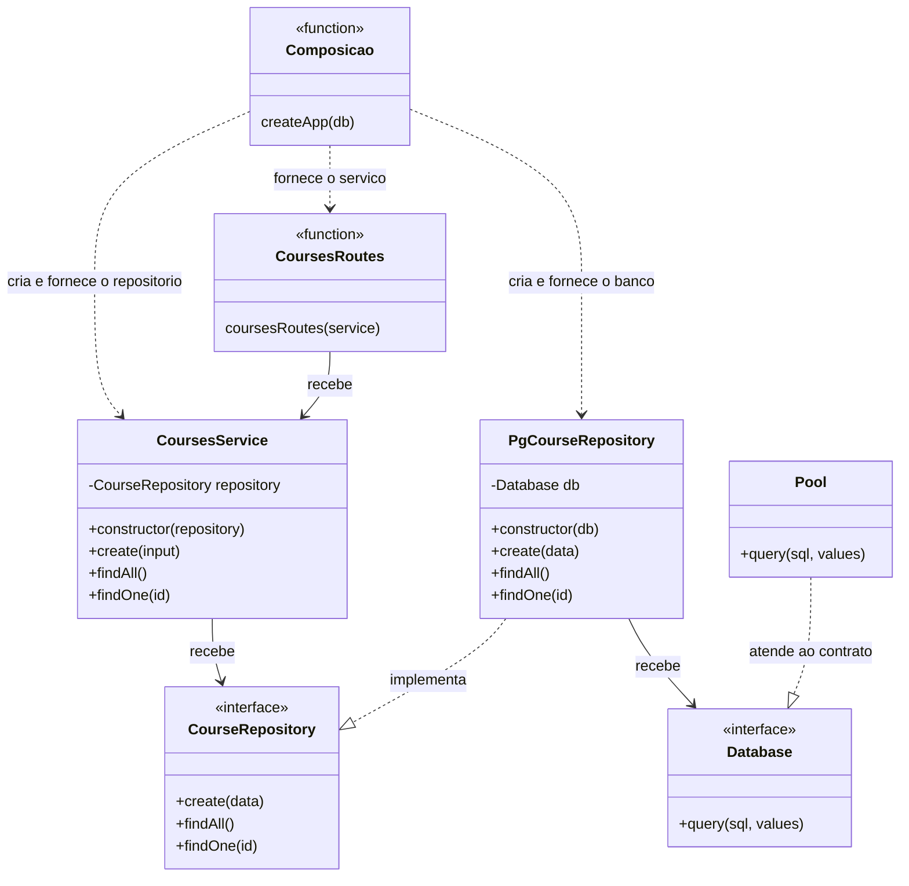
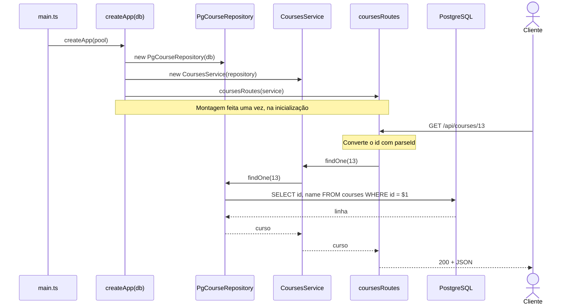

# Atividade 3 — Injeção de dependência em uma API Express com TypeScript

API REST em Express com TypeScript e PostgreSQL que cadastra alunos, cursos e matrículas. A aplicação sobe com Docker Compose em três serviços: o banco, já com dados iniciais; o servidor da API; e uma interface web servida pelo Nginx, que monta requisições de exemplo e mostra a resposta completa de cada uma.

O projeto base veio pronto no roteiro da atividade e já funcionava. Nele, só o módulo de alunos recebia as dependências de fora, servindo de referência; cursos e matrículas criavam os próprios objetos com `new` e usavam o pool de conexões importado diretamente. O que foi desenvolvido aqui é a refatoração desses dois módulos para o mesmo padrão, sem mudar endpoints, corpos JSON, validações, códigos HTTP nem consultas SQL.

## O que foi praticado

- Injeção de dependência pelo construtor e por parâmetros de função, sem biblioteca nem contêiner de injeção.
- Contratos em interfaces TypeScript (`CourseRepository`, `EnrollmentRepository`) para que os serviços dependam de uma abstração, e não da classe que fala com o PostgreSQL.
- Tipagem estrutural: o `Pool` do driver `pg` satisfaz a interface `Database` só por oferecer o método `query`, sem precisar declarar `implements`.
- Raiz de composição: toda a montagem dos objetos fica em `createApp(db)`, que cria repositórios, serviços e rotas uma única vez, na inicialização.
- Refatoração que preserva comportamento, verificada com `tsc --noEmit`, com o build e com chamadas à API rodando no Docker.

## Antes e depois

| Camada | Antes (cursos e matrículas) | Depois |
| --- | --- | --- |
| Rotas | `coursesRoutes()` criava o serviço com `new` | `coursesRoutes(service)` recebe o serviço pronto |
| Serviço | Instanciava `PgCourseRepository` num campo privado | Recebe um `CourseRepository` pelo construtor |
| Repositório | Importava o `pool` de `connection.ts` | Recebe um `Database` pelo construtor e chama `this.db.query` |
| `app.ts` | Registrava as rotas sem passar nada | Usa o `db` de `createApp` para montar a cadeia completa |

Matrículas seguiu exatamente as mesmas etapas, com `EnrollmentRepository`, `EnrollmentsService` e `enrollmentsRoutes`.

A composição em [server/src/app.ts](server/src/app.ts) ficou assim:

```ts
const coursesRepository = new PgCourseRepository(db);
const coursesService = new CoursesService(coursesRepository);

const enrollmentsRepository = new PgEnrollmentRepository(db);
const enrollmentsService = new EnrollmentsService(enrollmentsRepository);

app.use("/api/courses", coursesRoutes(coursesService));
app.use("/api/enrollments", enrollmentsRoutes(enrollmentsService));
```

## Estrutura de dependências

Os três módulos passaram a ter o mesmo desenho. O diagrama mostra cursos; alunos e matrículas são análogos. Funções aparecem com o estereótipo `function`, já que não são classes.



## Montagem na inicialização

`main.ts` entrega o pool à aplicação, e `createApp` monta a cadeia antes de qualquer requisição chegar. Depois disso, cada chamada HTTP só percorre objetos que já existem.



## Rotas

| Método | Rota | Descrição |
| --- | --- | --- |
| `GET` | `/api/students` | Lista os alunos em ordem de nome |
| `POST` | `/api/students` | Cadastra um aluno (`{ "ra": 258099, "name": "..." }`) |
| `GET` | `/api/students/:ra` | Busca um aluno pelo RA |
| `GET` | `/api/courses` | Lista os cursos em ordem de id |
| `POST` | `/api/courses` | Cadastra um curso (`{ "name": "..." }`) |
| `GET` | `/api/courses/:id` | Busca um curso pelo id |
| `GET` | `/api/enrollments` | Lista as matrículas |
| `POST` | `/api/enrollments` | Matricula um aluno (`{ "studentRa": 258099, "courseId": 13 }`) |
| `GET` | `/api/enrollments/student/:studentRa/course/:courseId` | Busca uma matrícula específica |
| `GET` | `/health` | Verificação de saúde usada pelo Docker Compose |

| Status | Situação |
| --- | --- |
| `200` / `201` | Consulta atendida / registro criado |
| `400` | JSON inválido, corpo que não é objeto, RA ou id que não é inteiro positivo, nome fora do tamanho |
| `404` | Registro inexistente, rota desconhecida ou matrícula com aluno ou curso inexistente |
| `409` | RA, nome de curso ou matrícula já cadastrados |
| `413` | Corpo da requisição grande demais |

Os erros chegam a um único tratador em `app.ts` e saem sempre no mesmo formato:

```json
{ "statusCode": 404, "message": "Curso com ID 99 não encontrado.", "error": "Not Found" }
```

## Banco de dados

| Tabela | Colunas | Observações |
| --- | --- | --- |
| `students` | `ra`, `name` | `ra` é a chave primária |
| `courses` | `id`, `name` | `id` serial; `name` único |
| `enrollments` | `student_ra`, `course_id`, `enrolled_at` | Chave composta, chaves estrangeiras para as duas tabelas |

Na primeira inicialização, o contêiner do banco roda [database/init.sql](database/init.sql) e [database/seed.sql](database/seed.sql), que cadastram 3 alunos, as 39 disciplinas do curso e 22 matrículas.

## Como executar

Requisitos: Docker com o plugin Docker Compose.

```bash
cp .env.example .env
docker compose up -d --build
```

| Recurso | Endereço |
| --- | --- |
| Interface web | http://localhost:8080 |
| API | http://localhost:3002/api |
| PostgreSQL | `localhost:5433` |

Os dados ficam no volume `atv3_database_data`. Para parar os serviços, `docker compose down`; para apagar também o banco e recomeçar do seed, `docker compose down -v`.

Dentro de `server/`, com Node.js 20.6 ou superior:

| Script | Descrição |
| --- | --- |
| `npm run typecheck` | Verifica os tipos sem gerar arquivos |
| `npm run build` | Compila o TypeScript para `dist/` |
| `npm run dev` | Sobe a API com recarga automática, lendo o `.env` da raiz |
| `npm start` | Sobe a API compilada |

Para rodar a API fora do Docker, suba só o banco com `docker compose up -d database` e sobrescreva o host e a porta na linha de comando, já que as variáveis do ambiente têm prioridade sobre o `.env`:

```bash
DB_HOST=localhost DB_PORT=5433 npm run dev
```

## Estrutura

```
.
├── database/
│   ├── Dockerfile
│   ├── init.sql
│   └── seed.sql
├── front/
│   ├── Dockerfile
│   ├── app.js
│   ├── index.html
│   ├── nginx.conf
│   └── style.css
├── server/
│   ├── src/
│   │   ├── database/
│   │   │   ├── connection.ts
│   │   │   ├── foreign-key-violation.ts
│   │   │   └── unique-violation.ts
│   │   ├── modules/
│   │   │   ├── courses/
│   │   │   ├── enrollments/
│   │   │   └── students/
│   │   ├── app.ts
│   │   ├── errors.ts
│   │   ├── main.ts
│   │   └── validation.ts
│   ├── Dockerfile
│   ├── package.json
│   ├── tsconfig.build.json
│   └── tsconfig.json
├── .env.example
├── compose.yml
└── README.md
```

## Contexto

Atividade da disciplina Desenvolvimento Web II do curso de Desenvolvimento de Software Multiplataforma da Fatec Jacareí.
